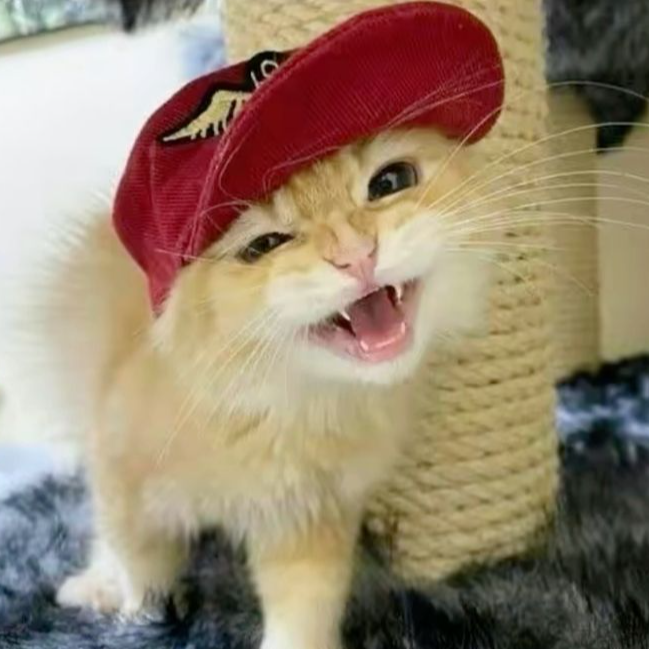

# hello! 🌀🐑🦋

welcome to my humble corner of GitHub. I do a lot of random little personal projects, which are pretty much all kept open source, and you can find them here.

I currently study undergraduate Computer Engineering at the University of Illinois Urbana-Champaign, with an interest in systems-level programming and GPU development.

the programs I write include [single-purpose](https://github.com/ambrosia13/mosaics) [command](https://github.com/ambrosia13/advent_of_ambrosia_2022) [line](https://github.com/ambrosia13/aoc_2023_rs) [programs](https://github.com/ambrosia13/BUNO), various [libraries](https://github.com/ambrosia13/word_search), and useful [tools](https://github.com/ambrosia13/gpu_layout) for [graphics](https://github.com/ambrosia13/wgputil) and [games](https://github.com/ambrosia13/icosphere) programming.

as you can probably tell by now, I love working with graphics and the GPU, and have several big projects to share. notably, I've worked on [Forget-me-not Shaders](https://github.com/ambrosia13/ForgetMeNot-Shaders), which is a Minecraft shaderpack that's accumulated over [65,000 downloads](https://github.com/ambrosia13/ForgetMeNot-Shaders) over the years. I was also the first to implement a shaders-only seasons feature in the Minecraft community! 

additionally, I've been working on a standalone rendering engine and path tracer, [marigold](https://github.com/ambrosia13/marigold), with the eventual goal of achieving the most amount of flexibility seen in a light transport simulator. although marigold has a long way to go, you can find more polished earlier iterations of the project [here](https://github.com/ambrosia13/goldenrod) and [here](https://github.com/ambrosia13/goldenrod_renderer).

my favorite general-purpose language is Rust, which is what many of my projects are made out of, but I also use a lot of C# (for Unity and Godot projects), C, and sometimes Python. it's a personal goal of mine to learn Zig use it to write a toy operating system , since I've learned how to build a kernel in C in university and would love to explore how much deeper I can go.

in general, I really enjoy challening myself by using handwritten code to introduce creative spins on common programming approaches, and I think I write the best code when I'm simultaneously exercising my creative muscle. I hope that wherever my coding skills take me, it'll be a place where I can utilize both my technical skills and creative side to make software that improves the quality standard of both indie & commercial software.

I hope you enjoyed reading my profile! feel free to look at any of my work in the 'repositories' tab. have a nice day!

